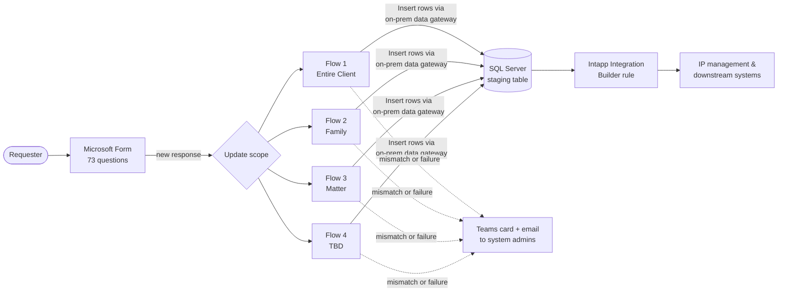
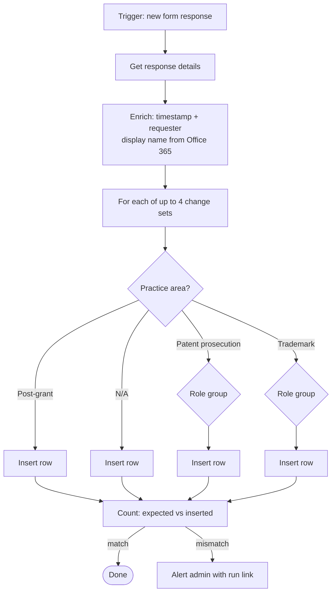

## The problem

IP Operations needed a reliable way for attorneys and staff to request **staffing changes on patent and trademark matters** — who is the handling attorney, supervising attorney, paralegal, or billing contact — by client, matter family, or individual matter.

There was no structured intake for this. An Intapp Integration Builder rule already existed that could apply staffing changes to downstream systems, but it only reads from a SQL Server table. The gap was getting accurate, well-formed requests *into* that table without someone re-keying them.

**Constraints**
- Requesters are non-technical; the form has to do the structuring, not the user.
- One request can contain up to **four separate staffing changes**, each for a different practice area and role.
- Bad data doesn't just fail — it can **change staffing on the wrong matters**. Data integrity mattered more than speed.
- The database is on-premises; cloud automation has to reach it through a data gateway.

## What I built

A Microsoft Forms → Power Automate → SQL Server pipeline that turns each form submission into one or more clean, structured rows for the existing Integration Builder rule to pick up.

- **1 Microsoft Form, 73 questions**, heavily branched by update scope, practice area, and role.
- **4 Power Automate flows**, one per update scope (Entire Client, [Family], [Matter], [4th scope — TBD]). Splitting by scope kept each flow testable and kept a change to one path from breaking the others.
- **Up to 24 conditional insert paths per flow**, routing each change to the correct row shape based on practice area (patent prosecution, post-grant, trademark, or not applicable) and role.
- **Built-in reconciliation**: each flow counts the rows it *expected* to write vs. the rows it *actually* wrote, and alerts an admin if they differ.
- **Failure alerting**: a Teams adaptive card and an email, both with a deep link straight to the failed run and the submission ID.

**My role:** gathered requirements with IP Operations, designed the flow architecture, built and tested all four flows, and own ongoing support and enhancements. The IP Operations team created the SQL table and the form questions.

## How it works

### System view

### Inside one flow

### Design decisions

| Decision | Why |
|---|---|
| Four flows, one per update scope | The form branches hard on one question. Separate flows mean smaller blast radius, simpler testing, and run history that's easy to read. |
| Role-group routing before insert | Different roles populate different columns. Routing first keeps every row in the exact shape the Integration Builder rule expects. |
| Expected-vs-inserted row count | A flow can "succeed" and still write nothing if a form answer doesn't match any branch. Counting catches silent gaps, not just hard failures. |
| Deep links in alerts | Whoever triages a failure goes straight to the run and submission — no hunting through run history. |
| Requester name looked up, not typed | Pulled from Office 365 by the responder's sign-in, so it can't be misspelled. |

## Results

- **In production since November 2024**
- **~10,000 form submissions processed** to date
- **0 manual SQL entries** — every request flows to the staging table automatically
- **[TBD]** minutes of manual handling avoided per request *(what would the alternative have been — email + manual entry?)*
- **[TBD]** failed or mismatched runs caught by alerts *(if you can pull it from run history)*
- **[TBD]** staffing changes applied (rows written), if it differs meaningfully from submissions

## Screenshots & demo

<!-- Scrubbed screenshots go in /public/case-studies/ip-staffing-updates/ -->
- [ ] Form: first page + one branched section (fake client/attorney data)
- [ ] Flow designer: top-level scopes collapsed
- [ ] Flow designer: one change-set expanded showing practice-area/role branching
- [ ] Teams failure card (fake values)
- [ ] Optional: 60–90s demo video, submit form → row appears in table

## What I'd do next

- Move the timezone conversion from a fixed offset to `convertTimeZone()` so timestamps stay correct across daylight saving time.
- Collapse the repeated insert blocks into a child flow or a single parameterized insert to cut maintenance across 24 paths.
- [Optional: Power BI view of request volume by practice area and role]
