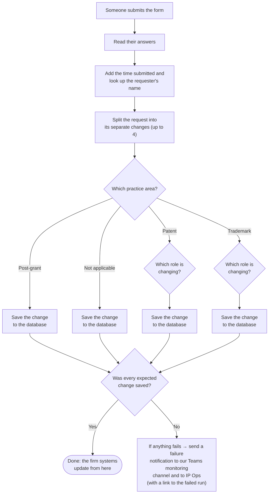

## The problem

At a law firm, every patent and trademark **matter** (a client's case or file) has a team assigned to it: a handling attorney, a supervising attorney, paralegals, and a billing contact. People change roles, join, and leave, so those assignments need updating constantly. The IP Operations team is responsible for keeping them accurate.

In early 2024, IP Operations built a **Microsoft Form with 73 questions** so attorneys and staff could request these staffing changes in a consistent way. A request can cover a whole client, a group of related matters (a "family"), or a single matter.

The form solved how requests came in, but not what happened next. **For every response, someone on IP Operations had to:**
1. Read and check the response by hand.
2. Log in to the firm's IP management system and make the change.
3. Make the same change again in the firm's practice management system.

That's two systems updated by hand, for every request, at a volume that now averages about 19 requests per business day.

**What made it tricky**
- **One response can hold up to four separate changes** (two for removals), each for a different practice area and role.
- **Mistakes are costly.** A wrong update doesn't just fail; it can change who is assigned to the wrong matters. Accuracy mattered more than speed.
- **The firm's database sits on its own servers**, not in the cloud, so the automation needed a secure way to reach it.

## What was built, and by whom

### Built by IP Operations
- **The Microsoft Form (73 questions).** Already in place before this project. Requesters answer questions that branch based on their earlier answers, so the form collects exactly the details each type of change needs.
- **The database table.** A table in the firm's SQL Server database, designed to hold one row per staffing change.
- **The Integration Builder rule.** Intapp Integration Builder is a tool that moves data between the firm's systems. IP Operations built the rule that picks up each new row from the database table and applies the change to both the IP management system and the practice management system.

### What I built
- **Four automated flows in Power Automate**, one for each type of request: **Entire Client, Family, Matter, and Removal**. Each flow starts the moment someone submits the form. Keeping them separate means a change to one type of request can't break the others.
- **The routing logic inside each flow.** It reads the response, splits it into its separate changes, works out which practice area and role each change applies to, and saves each one as a correctly shaped row in the database table. A change is saved when its practice area and role match one of these paths; a single flow has up to 24 of them.
- **The requester lookup.** The form already records which account submitted it. The flow uses that account to look up the requester's name, so nobody types it in.
- **A completeness check.** Each flow counts how many changes it *should* save and how many it *actually* saved. If a change doesn't match any path, or a save fails, the numbers won't match and a failure notice goes out. Nothing is silently dropped.
- **Failure notifications to two audiences.** If anything goes wrong, a notice goes to:
  1. **Our internal Teams channel**, where my department monitors every flow we build.
  2. **The IP Operations stakeholders**, so they know right away that a request failed and that we're already troubleshooting it.

  Each notice includes a direct link to the failed run and the form response, so whoever picks it up can go straight to the problem.

**My role:** I gathered the requirements with IP Operations, designed the solution, built and tested the four flows, worked with IP Operations so every saved row matched what their Integration Builder rule expects, and support and improve it in production.

## How it works

### The big picture

<figure class="sysmap" aria-label="System overview: form, flows, database and Integration Builder, then the firm's two systems, with failure notices branching off">
  <ol class="sm-row">
    <li class="sm-node">
      1
      <strong>Microsoft Form</strong>
      Requester submits a staffing change
      Built by IP Ops
    </li>
    <li class="sm-arrow">new response</li>
    <li class="sm-node sm-mine sm-flows">
      2
      <strong>Power Automate flows</strong>
      One per kind of change
      Entire ClientFamilyMatterRemoval
      Built by me
    </li>
    <li class="sm-arrow">one row per change</li>
    <li class="sm-node sm-stack">
      3
      <strong>Database table</strong>Built by IP Ops
      new rows picked up
      <strong>Integration Builder rule</strong>Built by IP Ops
    </li>
    <li class="sm-arrow">changes applied</li>
    <li class="sm-node sm-end">
      4
      <strong>Firm systems updated</strong>
      IP management system
      Practice management system
    </li>
  </ol>
  

    !
    
<strong>If anything fails</strong> in step 2, a failure notice goes to <strong>our Teams monitoring channel</strong> and to <strong>IP Operations</strong>, with a link to the failed run.

  

</figure>

1. Someone submits the form.
2. Based on the kind of change, one of the four flows picks it up.
3. The flow saves each change as a row in the firm's database.
4. The Integration Builder rule reads the new rows and updates both firm systems.
5. If anything fails along the way, both audiences are notified.

### Inside one flow

### Why it's built this way

| Choice | Why it matters |
|---|---|
| Four flows instead of one | The form splits early on the kind of change. Separate flows are easier to test, and a fix to one can't break the others. |
| Sorting by practice area and role before saving | Different roles fill in different fields. Sorting first means every row arrives in exactly the shape the Integration Builder rule expects. |
| Counting expected vs. saved changes | A flow can finish without an error and still miss a change if an answer doesn't match any path. The count catches those quiet misses. |
| Notifying two audiences | My team can start fixing the problem, and IP Operations isn't left wondering whether a request went through. |
| **Requester identity comes from the form itself, not typed in** | The form already records who submitted it, so the flow uses that account to look up the requester. The name is always correct and always tied to the actual person who submitted the request, with no typos or impersonation. |

## Results

- **In production since November 2024**, with close to **10,000 requests** processed as of November 2026.
- **Every qualifying change is written to the database automatically, with no manual re-entry.** A change qualifies when its practice area and role match one of the flow's paths. Anything that doesn't match is caught by the completeness check and flagged, not lost.
- **IP Operations no longer updates both systems by hand** for these requests. The Integration Builder rule applies each saved change to both.
- **Changes arrive complete and consistent.** Every saved change has the same set of details in the same format.
- **Problems are flagged immediately.** Failures go straight to the people who fix them and the people who depend on them.

*Hours avoided is an estimate: 9,940 requests at 5–10 minutes of manual work each.*

## Screenshots

*Recreated with sample data. Names, emails, client numbers, and system details are fictional.*

<figure>
  
  <figcaption>The request form IP Operations built: 73 questions, with a warning up front because a wrong answer changes real matters.</figcaption>
</figure>

<figure>
  
  <figcaption>The form branches: each answer sends the requester to the next question that applies to them.</figcaption>
</figure>

<figure>
  
  <figcaption>One of the four flows I built: read the response, handle up to four changes, then either confirm everything was saved or send a failure notice.</figcaption>
</figure>

<figure>
  
  <figcaption>One change, opened up: practice area, then role, then save. The panel on the right shows each form answer being placed into a database field.</figcaption>
</figure>

<figure>
  
  <figcaption>A failure notice in our Teams monitoring channel. IP Operations is notified at the same time, so both teams know a fix is underway.</figcaption>
</figure>
