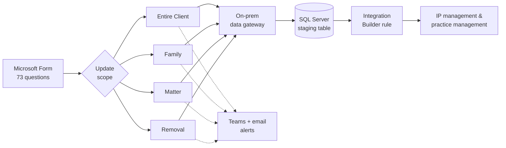
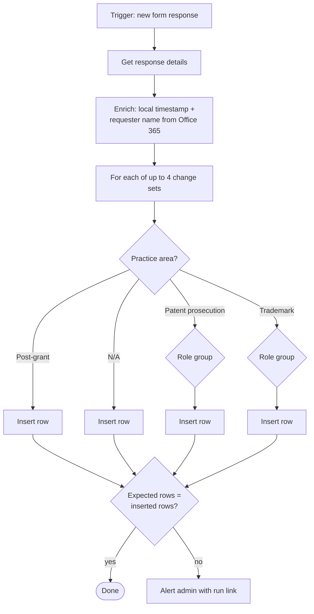

## The problem

IP Operations needed a reliable way for attorneys and staff to request **staffing changes on patent and trademark matters**: who is the handling attorney, supervising attorney, paralegal, or billing contact. These changes can apply to a whole client, a matter family, or a single matter.

Requests came in by email to the IP Operations team, and someone made each update by hand. There was no structured intake. An Intapp Integration Builder rule already existed that could apply staffing changes to the firm's IP management system (Foundation IP) and practice management system, but it only reads from a SQL Server table. The gap was getting accurate, well-formed requests *into* that table without anyone re-keying them.

**Constraints**
- Requesters aren't technical, so the form has to do the structuring.
- One request can contain up to **four separate staffing changes** (two for removals), each for a different practice area and role.
- Bad data doesn't just fail. It can **change staffing on the wrong matters**, so data integrity mattered more than speed.
- The database is on-premises, so cloud automation has to reach it through a data gateway.

## What I built

A Microsoft Forms → Power Automate → SQL Server pipeline that turns each form submission into one or more clean, structured rows for the existing Integration Builder rule to pick up.

- **1 Microsoft Form, 73 questions**, branched by update scope, practice area, and role.
- **4 Power Automate flows**, one per update scope: **Entire Client, Family, Matter, and Removal**. Splitting by scope keeps each flow testable and stops a change to one path from breaking the others.
- **Up to 24 conditional insert paths per flow**, routing each change to the correct row shape based on practice area (patent prosecution, post-grant, trademark, or not applicable) and role.
- **Built-in reconciliation**: each flow compares the number of rows it *expected* to write with the number it *actually* wrote, and alerts an admin if they differ.
- **Failure alerting**: a Teams adaptive card and an email, both with a deep link to the failed run and the submission ID.

**My role:** I gathered requirements with IP Operations, designed the flow architecture, built and tested all four flows, and own ongoing support and enhancements. The IP Operations team created the SQL table and the form questions.

## How it works

### System view

### Inside one flow

### Design decisions

| Decision | Why |
|---|---|
| Four flows, one per update scope | The form branches hard on one question. Separate flows mean a smaller blast radius, simpler testing, and run history that's easy to read. |
| Role-group routing before insert | Different roles populate different columns. Routing first keeps every row in the exact shape the Integration Builder rule expects. |
| Expected-vs-inserted row count | A flow can "succeed" and still write nothing if a form answer doesn't match any branch. Counting catches silent gaps, not just hard failures. |
| Deep links in alerts | Whoever triages a failure goes straight to the run and the submission instead of searching run history. |
| Requester name looked up, not typed | Pulled from Office 365 using the responder's sign-in, so it can't be misspelled. |

## Results

- **In production since November 2024.** Close to **10,000 submissions** have gone through the form.
- **Every request lands in SQL automatically.** IP Operations no longer re-keys staffing changes from email.
- **Requests arrive structured.** Scope, practice area, role, and attorney are captured as discrete fields, not free text in an email.
- **Problems surface on their own.** Reconciliation and failure alerts flag a bad run with a direct link to fix it.

*Hours avoided is an estimate: 9,940 requests at 5–10 minutes of manual handling each.*

## Screenshots

*Recreated with sample data. Names, emails, client numbers, and system details are fictional.*

<figure>
  
  <figcaption>The intake form: 73 questions, with warnings up front because a bad answer changes real matters.</figcaption>
</figure>

<figure>
  
  <figcaption>Branching rules route each requester down a different path by scope, jurisdiction, and practice area.</figcaption>
</figure>

<figure>
  
  <figcaption>One flow, top level: enrich, four change-set scopes, then a failure path and a row-count reconciliation.</figcaption>
</figure>

<figure>
  
  <figcaption>Inside a change set: practice area → role group → Insert row, with form answers mapped to SQL columns.</figcaption>
</figure>

<figure>
  
  <figcaption>Failure alert in Teams, with deep links to the failed run and the form responses.</figcaption>
</figure>

## What I'd do next

- Collapse the repeated insert blocks into a child flow or a single parameterized insert, so a schema change means editing one action instead of 24.
- Add a Power BI view of request volume by scope, practice area, and role to help IP Operations plan workload.
